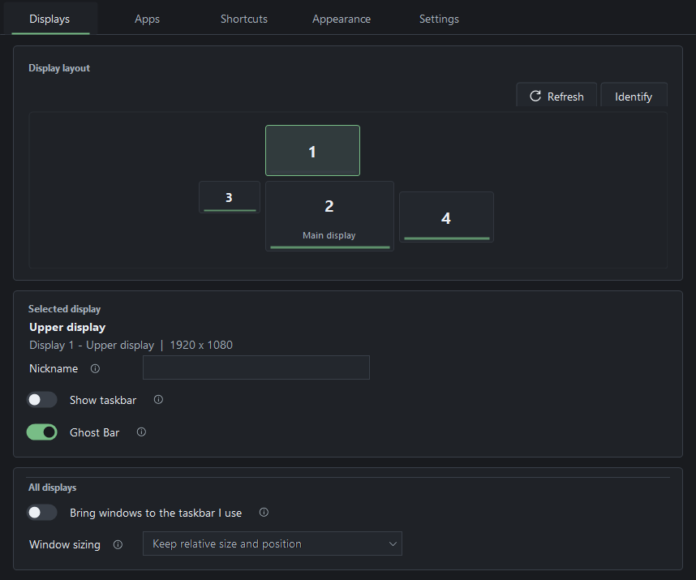
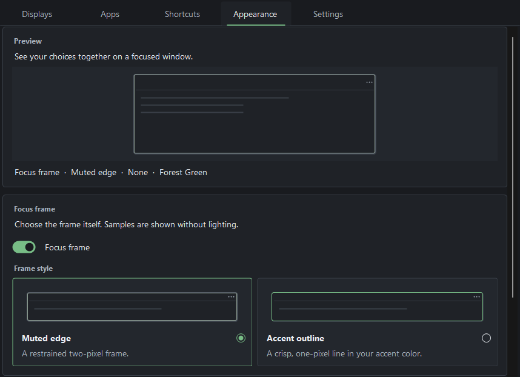
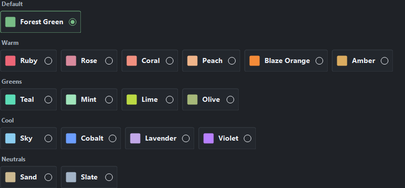
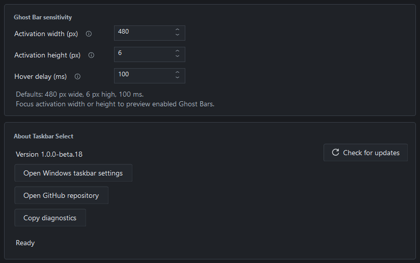

# Taskbar Select

**Bring windows to the screen you're using.**

Choose which monitors show a Windows taskbar, move windows by clicking their taskbar icons on another screen, and use **Ghost Bar** where the taskbar is hidden.

**Beta 18 · Windows 11 x64 · Unsigned downloads**

[Download Setup](https://github.com/mrlevivel/TaskbarSelect/releases/download/v1.0.0-beta.18/TaskbarSelect-1.0.0-beta.18-Setup.exe) · [Releases and checksums](https://github.com/mrlevivel/TaskbarSelect/releases) · [Watch the demo](#see-it-in-action) · [User guide](docs/USER_GUIDE.md)

*Actual beta 18 controls with illustrative monitor data. [How the previews were made](docs/images/README.md).*

## What it does

- **Choose your taskbars.** Hide selected secondary taskbars and keep the main one visible.
- **Bring a window here.** Click its taskbar icon on another monitor to move it there, with relative sizing and Undo.
- **Reach apps with Ghost Bar.** Hover near a hidden taskbar's bottom-center edge to find open windows or search for an app on the display you last focused.
- **Work from the keyboard.** Move, minimize, pin, focus and arrange windows. Undo also restores shortcut minimizes; a lit corner identifies a pinned window.
- **Make it yours.** Choose accent colors, focus-frame styles and optional lighting. Pause movement or restore the taskbars whenever you need to.

## See it in action

[Watch the narrated overview — 2 minutes 17 seconds](https://github.com/mrlevivel/TaskbarSelect/releases/download/v1.0.0-beta.18/TaskbarSelect-overview.mp4)

The beta 18 overview shows taskbar moves, Ghost Bar, shortcuts, search, layouts and focus frames using neutral demo windows. See the [user guide](docs/USER_GUIDE.md) for more details.

## Install and get started

1. Download **Setup** and **SHA256SUMS.txt** from the [beta 18 release](https://github.com/mrlevivel/TaskbarSelect/releases/tag/v1.0.0-beta.18), and compare the installer's SHA-256 with its checksum entry. Run Setup, then open Taskbar Select from Start.
2. In Windows **Settings > Personalization > Taskbar > Taskbar behaviors**, enable **Show my taskbar on all displays**.
3. In Taskbar Select, use **Identify**, select a secondary display and turn **Show taskbar** Off to hide it. Enable **Ghost Bar** there if you want an app switcher at the bottom edge.
4. Enable **Bring windows to the taskbar I use** to move windows by clicking their icons on another monitor's taskbar.

**Downloads are unsigned.** Windows protections may warn or block them. Checksums verify file integrity rather than publisher identity. Keep Windows security protections enabled; stop and verify the source or report a problem if blocked.

Setup installs for your Windows user. Windows 11 normally includes the required .NET Framework runtime. A portable ZIP is also available; extract it completely before running. GitHub's **Source code** archives contain the project rather than a ready-to-run app.

Closing Settings leaves the app in the notification area. Use its tray icon to reopen it or choose **Restore and exit**. Startup is optional. Installed and portable copies share saved preferences; [use an isolated profile](docs/USER_GUIDE.md#isolated-portable-trial) for a separate trial.

## Shortcuts, updates and more

See the [user guide](docs/USER_GUIDE.md) for the full shortcut reference, sizing modes, app exclusions, Chrome's **Open new window** search action and appearance controls. The Shortcuts page adds one movement row per connected display and retains saved bindings when a display disconnects.

**Administrator support is optional.** Enable it in Settings for eligible elevated windows such as Task Manager. Before upgrading or uninstalling, turn it fully **Off** and approve Windows' removal prompt if requested. A changed build needs fresh approval when you enable it again. [Administrator support and maintenance](docs/USER_GUIDE.md#optional-administrator-support).

Use **Settings > Check for updates** for published releases. Installed copies offer a separate download and installation confirmation; portable and isolated copies update manually. Preferences and Startup choices are preserved on upgrade. [Update and migration details](docs/USER_GUIDE.md#startup-updates-and-uninstall).

Appearance and Settings previews

These are cropped previews of real controls with neutral demo data. They do not demonstrate animation or runtime acceptance. See the [image details](docs/images/README.md).

## Beta limitations

- **Windows 11 x64.** Physical testing has mainly used one four-monitor PC. Windows 10 and replacement taskbars have not been validated; Windows updates can change Explorer behavior.
- **Native snapping can retain the old taskbar gap.** Optional **Shortcuts > Experimental snapping** provides separate Windows+Left/Right half-window placement and monitor cycling. It starts Off each launch; Snap Assist, groups and quarter layouts can behave differently.
- Mixed scaling, stacked or disconnected displays, prolonged lock/wake, different-account Windows approval and protected apps have limited physical coverage. An app can refuse an operation even with administrator support.
- Rocket League worked in **Borderless**; exclusive **Fullscreen** resisted monitor moves.

Read the [release notes](https://github.com/mrlevivel/TaskbarSelect/releases/tag/v1.0.0-beta.18) and [testing scope](TESTING.md) for the qualified download's results and limits.

## Help and privacy

Use **Pause all** to restore managed taskbars. If the interface is unavailable, run `TaskbarSelect.exe --restore` from its folder. Retain the files and follow the [recovery guide](docs/USER_GUIDE.md#recovery) if recovery reports an error.

[Report a bug](https://github.com/mrlevivel/TaskbarSelect/issues/new/choose) with the app version and reproduction steps. Review diagnostics and screenshots before posting; keep private paths, window titles, raw settings and serial numbers out of public reports. Follow [SECURITY.md](SECURITY.md#reporting) for sensitive findings.

Taskbar Select has no telemetry, advertising or automatic update installation. Settings stay on your PC. Update checks and downloads contact GitHub when requested, without uploading local settings, diagnostics or window information. [Privacy details](docs/USER_GUIDE.md#privacy-and-diagnostics).

[MIT license](LICENSE) · [Build and contribute](CONTRIBUTING.md) · [Artwork](assets/ARTWORK.md)
