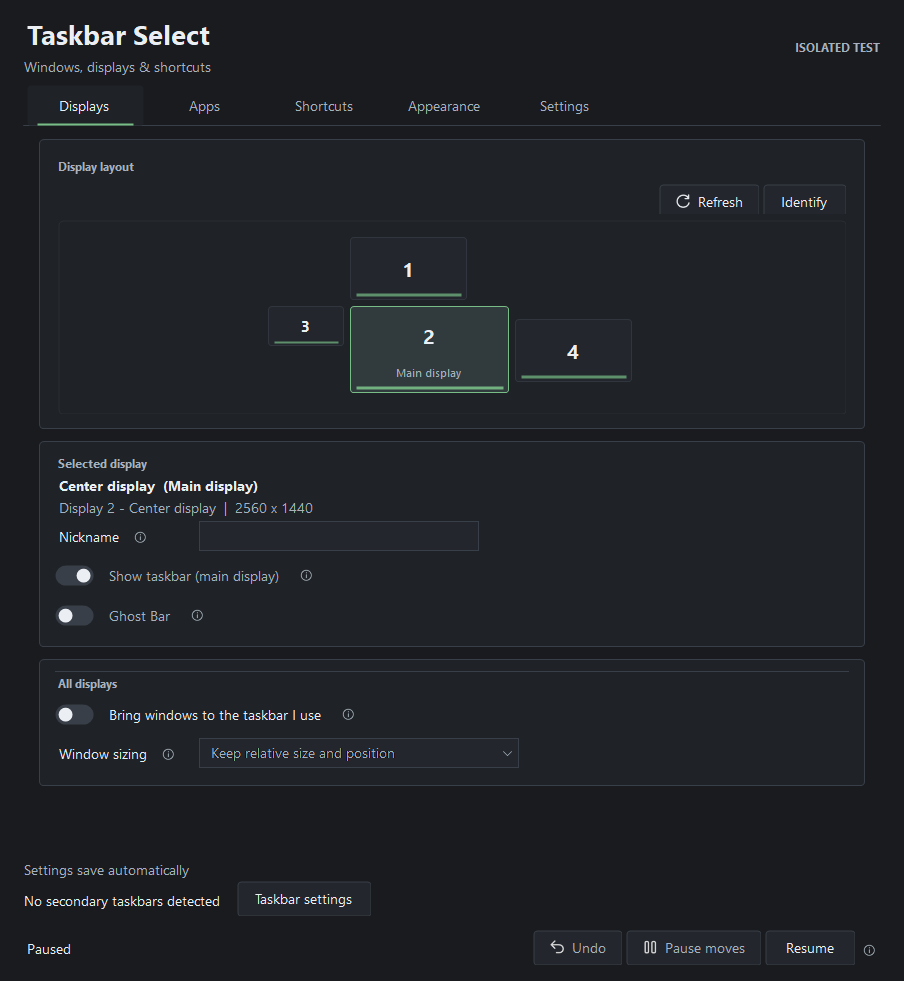
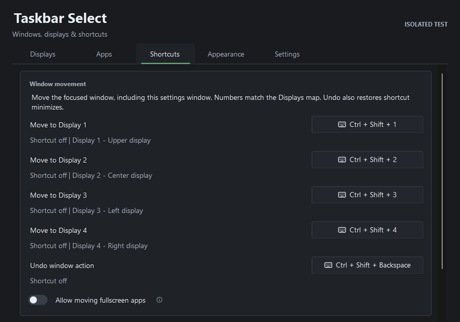
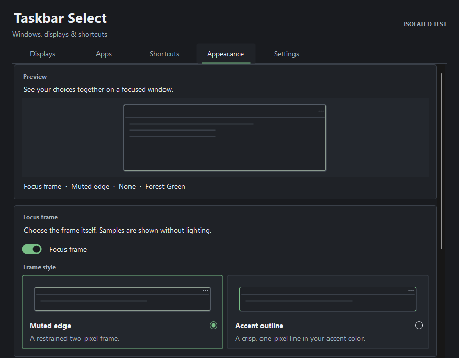
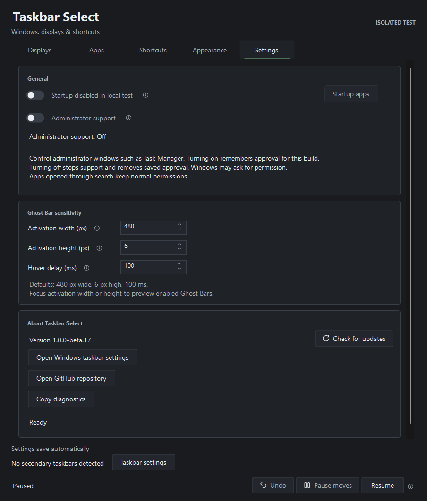

# Taskbar Select

**Bring windows to the screen you're using.**

Choose which displays show a Windows taskbar, move windows by clicking their taskbar icons on another screen, and use Ghost Bar on displays where the taskbar is hidden. Keyboard shortcuts bring app search, layouts, focus, minimize and always on top to the same workspace.

**Beta 18 for Windows 11 x64.** Downloads are unsigned. See the [compatibility notes](#compatibility) before installing.

[Download Setup](https://github.com/mrlevivel/TaskbarSelect/releases/download/v1.0.0-beta.18/TaskbarSelect-1.0.0-beta.18-Setup.exe) · [Release notes and checksums](https://github.com/mrlevivel/TaskbarSelect/releases/tag/v1.0.0-beta.18) · [User guide](docs/USER_GUIDE.md) · [Report a bug](https://github.com/mrlevivel/TaskbarSelect/issues/new/choose)

*These beta 17 control images use generic display data in a paused isolated profile. The controls are unchanged in beta 18; the older version label remains visible in the Settings image. The normal installed app omits the isolated-test label. [Image details](docs/images/README.md).*

## What you can do

- **Choose your taskbars.** Hide selected secondary taskbars, keep the main taskbar visible, and identify or nickname your displays.
- **Bring a window here.** Click its taskbar icon on another monitor to move it there. Grouped thumbnails, relative sizing, app exclusions and Undo are supported.
- **Use Ghost Bar.** Hover near the bottom-center edge of a display with a hidden taskbar to reveal an app switcher. Open app search on the display you last focused, then open or bring an app there.
- **Choose a new Chrome window.** Right-click a supported standard Google Chrome search result and choose **Open new window**. Ordinary click or Enter opens or brings an existing app window to the search display.
- **Work from the keyboard.** Move, minimize, close, pin, focus by direction, and arrange windows. A lit top-left corner marks a window pinned with always on top.
- **Match your workspace.** Choose from 17 grouped accent colors, two focus-frame styles and optional frame lighting. New profiles start with Forest Green, Muted edge and no lighting.
- **Pause when you need to.** Pause moves, pause all management, or restore and exit from the notification-area menu. Startup is optional.

Beta 18 fixes app search sometimes leaving desktop apps on their previous monitor instead of the display where search was opened. It retains connected-display shortcuts, relative sizing and maximized-move Undo. Its updater is bound to this repository. Read the [release notes](https://github.com/mrlevivel/TaskbarSelect/releases/tag/v1.0.0-beta.18) for the exact package's changes and validation.

## See it in action

[Watch the narrated overview — 2 minutes 13 seconds](https://github.com/mrlevivel/TaskbarSelect/releases/download/v1.0.0-beta.18/TaskbarSelect-overview.mp4)

The overview demonstrates taskbar moves, Ghost Bar, shortcuts, search, layouts and focus frames using neutral demo windows. It was recorded with an earlier isolated build and does not show every later addition.

## Install

1. Download **TaskbarSelect-1.0.0-beta.18-Setup.exe** and **SHA256SUMS.txt** from the [beta 18 release](https://github.com/mrlevivel/TaskbarSelect/releases/tag/v1.0.0-beta.18). Match the installer's SHA-256 to its entry in the checksum file.
2. Run Setup, then open **Taskbar Select** from the Windows Start menu. Setup installs for your Windows user.
3. For a portable copy, download **TaskbarSelect-1.0.0-beta.18-portable.zip**, extract it completely, and open `TaskbarSelect.exe`.

Windows 11 normally includes the .NET Framework runtime the app uses. GitHub's **Source code** archives contain the source project. Choose Setup or the portable archive to run the app.

**The executable and installer are unsigned.** Windows protections may warn or block them. Checksums verify file integrity. If a protection blocks the download or app, stop and check the source or report the problem. Keep Windows security protections enabled.

Installed and ordinary portable copies use the same saved profile. Before switching copies, choose **Restore and exit** from the running app's tray menu. A [separate portable trial](docs/USER_GUIDE.md#isolated-portable-trial) uses an explicit isolated profile.

## First run

1. In Windows **Settings > Personalization > Taskbar > Taskbar behaviors**, enable **Show my taskbar on all displays**.
2. In Taskbar Select, use **Identify**, select a secondary display, and turn **Show taskbar** Off to hide its taskbar. New displays keep their taskbars visible by default.
3. Turn **Ghost Bar** On for a display with a hidden taskbar, then hover at its bottom-center edge. Its activation height starts at 6 physical pixels and can be adjusted down to 1 in Settings.
4. Enable **Bring windows to the taskbar I use** to move windows by clicking taskbar icons on another screen. Clicking an icon on the window's current screen retains normal Windows behavior.

Closing the settings window leaves Taskbar Select in the notification area. Use its tray icon to reopen it or choose **Restore and exit**.

## Keyboard shortcuts

| Action | Default shortcut |
| --- | --- |
| Move the focused window to a display | Ctrl+Shift+1–4 for Displays 1–4 |
| Undo a move, layout or shortcut minimize | Ctrl+Shift+Backspace |
| Search apps on the last focused display | Ctrl+Shift+Space |
| Close the focused window | Ctrl+Shift+W |
| Minimize the focused window | Ctrl+Shift+M |
| Toggle always on top | Ctrl+Shift+P |
| Focus the nearest window in a direction | Ctrl+Alt+Shift+arrow |
| Open the layout picker | Ctrl+Alt+Shift+Space |

The **Shortcuts** tab shows one movement row per connected display. Assign a shortcut for any display beyond the first four, or change an existing binding. A disconnected display's shortcut stays saved for its Windows display number. Registration conflicts are shown beside the affected shortcut.

*Configured defaults in the isolated image fixture. Its shortcuts are not registered, so the preview displays “Shortcut off.” The running app reports actual registration status.*

Undo also restores windows minimized with Taskbar Select's minimize shortcut. Closing a window follows that app's normal save prompts. Taskbar Select releases its own always-on-top pins when it exits normally.

## Administrator support and updates

Taskbar Select normally runs with standard permissions. For administrator windows such as Task Manager, turn **Settings > Administrator support** On and approve Windows. Approval is remembered for that build and can be reused after reopening the app or restarting the PC. Apps opened through search retain normal permissions.

Before upgrading or uninstalling, turn that switch Off and wait for confirmed **Off**. Approve Windows' removal prompt if it appears. A cancelled or incomplete removal retains the saved approval and blocks maintenance. Each changed build needs a fresh approval if you want support again.

Open **Settings > Check for updates** to look for a newer release. Choose **Download update**, then **Install update** and confirm when ready. The updater uses public GitHub releases without a sign-in. While this repository is private, download updates manually from the release page. Portable and isolated copies also update manually.

For existing private beta 16 installations, install beta 18 manually once to move to the new updater address. Beta 17 already uses this repository. Setup upgrades preserve preferences and the Startup choice. Successful uninstall removes them after recovery. [Back up your choices](docs/USER_GUIDE.md#preserve-choices-before-a-fresh-install-trial) before uninstalling.

Appearance and Settings previews

These images use generic data and an isolated profile. They illustrate the controls without registering shortcuts, changing permissions or reading personal settings. Still images do not demonstrate frame animation.

## Compatibility

- **Windows 11 x64.** Most physical testing has been on one four-monitor PC. Wider hardware testing is part of this beta.
- Taskbar management relies on Explorer behavior that Windows updates can change. Windows 10 and replacement taskbars have not been validated.
- Native Windows snapping can leave the former taskbar strip. **Shortcuts > Experimental snapping** offers optional Windows+Left/Right half-window placement and monitor cycling. It starts Off each launch and uses full display bounds where the taskbar is hidden. Snap Assist, Snap groups and quarter layouts can behave differently in this mode.
- Mixed scaling, stacked or disconnected displays, prolonged lock/wake, different-account Windows approval and protected apps have limited physical coverage. An app can refuse an operation even with administrator support enabled.
- Rocket League was tested in **Borderless**. Its exclusive **Fullscreen** mode resisted both Taskbar Select and Windows' monitor shortcut.

The [release page](https://github.com/mrlevivel/TaskbarSelect/releases/tag/v1.0.0-beta.18) records the exact package's build, installer, administrator-boundary and updater results. The [testing guide](TESTING.md) describes automated coverage and remaining physical checks.

## Recovery, feedback and privacy

Use **Pause all** to restore managed taskbars. If the interface is unavailable, run `TaskbarSelect.exe --restore` from its folder. For an isolated trial, include its `--test-profile` argument. If recovery reports an error, retain the files and follow the [recovery guide](docs/USER_GUIDE.md#recovery).

[Report a bug](https://github.com/mrlevivel/TaskbarSelect/issues/new/choose) with the app version, Windows build, display arrangement and steps to reproduce it. **Copy diagnostics** in Settings is optional. Review it and any screenshots before posting, since display models and layout can identify your setup. Keep raw settings, private paths, window titles and serial numbers out of public reports. Use the [security reporting instructions](SECURITY.md#reporting) for sensitive findings.

Taskbar Select has no telemetry, advertising or automatic update installation. Settings and recovery data stay on your PC. Update checks and downloads contact GitHub when you request them and do not upload local settings, diagnostics, monitor data or window information. The app does not request a GitHub token. See the [privacy details](docs/USER_GUIDE.md#privacy-and-diagnostics).

[MIT licensed](LICENSE) · [Build from source](CONTRIBUTING.md) · [Artwork](assets/ARTWORK.md) · [Documentation images](docs/images/README.md)
